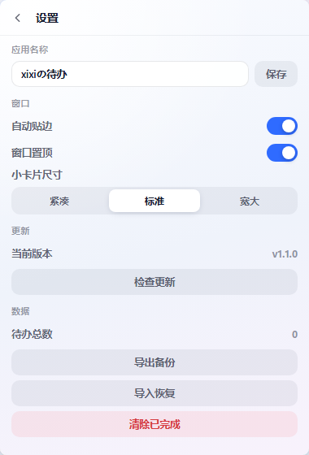

# xixiの待办清单·扁平桌面应用

Windows 桌面待办清单，扁平化视觉：纯色底、1px 分隔线、单一强调色，没有模糊与渐变光效。

**桌面小卡片**


**完整视图**


**设置页**（侧边栏底部或小卡片右下角进入，更新/备份/窗口配置都在这里）




---

## 安装

从 **[Releases](https://github.com/NiUKinGDoM/xixi-todo/releases/latest)** 下载
`xixi-todo-setup.exe`，双击安装：

- 装到 `%LOCALAPPDATA%\Programs\XiXiTodo`，**不需要管理员权限**，不弹 UAC
- 自动创建开始菜单与桌面快捷方式，安装时可勾选 **开机自启动**
- 控制面板「应用和功能」里能正常卸载
- 卸载**不删数据**，待办仍留在 `%APPDATA%\xixi-todo`，重装后接着用
- **升级**：下载新安装包直接运行即可覆盖安装，待办与窗口位置都不动
- 应用内「检查更新」会直接给你 Release 里的安装包地址

装完之后从桌面/开始菜单打开即可，和普通软件一样。应用内「检查更新」
也会直接给你新安装包的下载地址。

**两种形态，一键切换：**

- **桌面小卡片**（默认，380×560）—— 无边框圆角玻璃，浮在桌面上，默认置顶。适合挂在屏幕角落随手记事。
- **完整视图**（1080×720）—— 带侧边栏、进度统计、分类导航。

点标题栏的 ⛶ 按钮在两者间切换，数据完全共用。窗口位置、尺寸、置顶状态都会记住，下次打开回到原处。

**窗口操作用的是自绘标题栏**（因为无边框窗口没有系统标题栏）：

| 操作 | 位置 |
|---|---|
| 拖动窗口 | 按住标题栏左侧空白处拖动 |
| 自动贴边 | 拖到屏幕边缘松手即吸附（开关在设置里） |
| 自由缩放 | 拖右下角的小手柄，任意尺寸；设置里也有三档预设 |
| 应用改名 | 设置 → 名称，小卡片与完整视图同时生效 |
| 收进边缘 | 点最小化就缩成贴边小条（不管窗口在哪），点小条还原；可在设置里关掉 |
| 置顶开关 | 标题栏图钉按钮（高亮＝已置顶） |
| 小卡片 ⇄ 完整 | 标题栏 ⛶ 按钮 |
| 最小化 / 关闭 | 标题栏右端两个按钮 |
| 设置 | 完整视图：左侧栏底部「设置」；小卡片：右下角小齿轮 |

- 数据保存在 `%APPDATA%\xixi-todo\todos.json`
- 窗口状态保存在 `%APPDATA%\xixi-todo\window.json`
- 运行日志在 `%APPDATA%\xixi-todo\app.log`
- 单文件绿色版，约 12 MB，可直接复制到其他 Windows 电脑使用

---

## 功能

| 功能 | 说明 |
|---|---|
| 添加待办 | 输入后按 `Enter` 或点「添加」 |
| 快速语法 | 一句话自动识别，见下表 |
| 优先级 | 高 / 中 / 低，列表按优先级排序 |
| 截止日期 | 点「设置日期」选择，自动换算「今天 / 明天 / N 天后」 |
| 提醒时间 | 精确到分钟，到点弹 Windows 系统通知 |
| 重复任务 | 每天 / 每个工作日 / 每周 / 每月 / 每年，完成后自动滚到下一次 |
| 备注 | 每个任务可加补充说明，列表里折叠显示 |
| 拖拽排序 | 按住任务左侧把手上下拖，手动调整顺序 |
| 逾期高亮 | 过期未完成整行标红，标签显示「逾期 N 天」 |
| 勾选完成 | 点左侧方框切换；重复任务则滚到下一次并记录完成次数 |
| 编辑 / 删除 | 悬停任务点铅笔 / 垃圾桶图标 |
| 分类筛选 | 全部 / 今天 / 未完成 / 已逾期 / 已完成 |
| 进度统计 | 完成百分比与逾期数量 |
| 备份恢复 | 设置 → 导出备份 / 导入恢复（JSON） |
| 开机自启动 | 设置 → 启动 → 开机自启动（安装包安装时也能勾） |

### 快速添加语法

在输入框里直接写自然语言，回车即可：

| 写法 | 效果 |
|---|---|
| `明天 交报告` | 截止日期设为明天 |
| `9点开会` / `9:30 开会` | 提醒时间 09:00 / 09:30 |
| `明天9点开会` | 日期 + 时间一起识别（不用加空格） |
| `写方案 !高` | 优先级高（`!中` `!低` 同理） |
| `周会 每周` | 每周重复（`每天` `工作日` `每月` `每年` 同理） |
| `下周三 汇报` | 解析成下周三的日期 |
| `10月30日 面试` / `10-30 面试` | 指定月日，已过则顺延到明年 |
| `明天9点 客户拜访 !高 #工作 每天` | 全部组合，一次设置完 |

输入框下方会实时显示解析结果（蓝色小标签），所见即所得。

### 重复任务怎么算

点勾选框时不会把任务标成已完成，而是把截止日期推到下一个周期、继续留在列表里，同时 `doneCount` 加一。

- 从**原截止日期**往后推，一路推到「今天或之后」，不会积压一串过期实例
- 每月 31 号遇到小月会压到月末（1/31 → 2/28）
- 「每个工作日」自动跳过周六日

### 快捷键

- `Enter` — 在输入框内快速添加
- `Ctrl + Enter` — 任意位置快速添加
- `Esc` — 关闭编辑弹窗 / 菜单

---

## 检查更新

软件打开约 4 秒后会自动静默检查一次新版本（不打扰，只在标题栏齿轮按钮上点一个小红点）。
点齿轮 → **设置 → 检查更新** 可以手动检查，有新版本会弹出更新说明并给出下载入口。

### 更新源

版本信息放在仓库根目录的 `version.json`，按以下顺序依次尝试，任意一个成功即用：

| 顺序 | 源 | 说明 |
|---|---|---|
| 1 | `raw.githubusercontent.com` | 永远是最新的，保证发版后立刻生效 |
| 2 | `cdn.jsdelivr.net/gh/...` | 国内快，但对 `@main` 有最长 12 小时缓存 |
| 3 | `gh-proxy.com` | GitHub 加速镜像 |
| 4 | `ghfast.top` | 备用镜像 |

**下载链接**（`version.json` 里的 `downloads`）用的是另一套顺序，因为实测发现：

- jsDelivr 出于安全策略**不代理 exe**（返回 403）
- GitHub raw 对大文件在国内常返回 502

所以下载走 `gh-proxy` → `ghfast` → GitHub 页面，这三个都实测可用。

全部源都失败只会提示「检查失败，请检查网络」，不影响正常使用。

### 发新版本的步骤（每次改完必须走完）

**版本号不升 = 老用户永远收不到更新**，这一步最容易漏。

1. 改 `app.py` 的 `VERSION`（如 `1.2.0` → `1.2.1`）
2. 改 `version.json` 的 `version`、`date`、`notes`
3. 打包两步（`build.py` 只产中间产物，`build_installer.py` 出安装包）：
   ```bash
   venv\Scripts\python build.py            # → build\payload\xixi-todo.exe
   venv\Scripts\python build_installer.py  # → dist\xixiの待办清单-安装包.exe
   ```
4. 跑一遍全部测试：`run_tests.bat` 或手动跑四个脚本
5. 把安装包传进 GitHub Release（固定资产名 `xixi-todo-setup.exe`）：

```bash
# 新建 Release 并上传（tag 用版本号，资产名固定）
# 网页操作也可以：Releases → Draft a new release → 拖入 dist 里的安装包
```

资产名保持固定，配合 `releases/latest/download/xixi-todo-setup.exe`
这条链接，以后发版**不用改 version.json 里的 URL**。

6. 提交并推送版本清单（仓库不再存二进制）：

```bash
git add -A
git commit -m "release: v1.4.1"
git push
```

7. 清 jsDelivr 缓存（它对 `@main` 有最长 12 小时缓存，不清的话部分用户会读到旧清单）：

```bash
curl "https://purge.jsdelivr.net/gh/NiUKinGDoM/xixi-todo@main/version.json"
```

8. 复核：确认远程已经是新版本

```bash
curl -s "https://cdn.jsdelivr.net/gh/NiUKinGDoM/xixi-todo@main/version.json" | head -3
```

推上去后，已经装了旧版的用户在下次打开时就会收到更新提示。

> 注意：`version.json` 的 `downloads` 指向 **Release 资产**
> （`releases/latest/download/xixi-todo-setup.exe`），带 gh-proxy / ghfast 加速前缀。
> 仓库里**不再存二进制**，克隆体积不会随版本膨胀。
>
> `dist` 只是本地构建产物，已加入 `.gitignore`。便携版已经取消 ——
> 两个入口容易误点，而且便携版和安装版共用同一个数据目录，双开容易互相覆盖。

---

## 视觉：扁平化

整个界面只有三样东西支撑层次，不靠光效：

1. **纯色底**（`#f4f6fa`）+ **白色表面**（`#ffffff`）
2. **1px 发丝线**（`#e6eaf2`）做分区：侧边栏右边线、标题栏下边线、列表行分隔线
3. **单一强调色**（`#2563eb`）只出现在主按钮、选中态、开关打开态

具体规则：

- 没有任何 `backdrop-filter` / SVG 折射 / 多层阴影，`--glass-blur: 0`
- 圆角收敛到 9–14px（原来是 26px）
- 完整视图是**一整块连续界面**：侧边栏与主区之间只有一条分隔线，不再有浮起来的卡片感
- 小卡片是纯白窗，只有标题栏下一条线

历史说明：早期版本走过 Liquid Glass 路线（SVG 折射 + backdrop-filter），
视觉好看但在 380px 的小卡片上信息密度太低，已整体替换为扁平。

---

## 从源码重新构建

```bash
# 1. 准备环境（只需一次）
python -m venv venv
venv\Scripts\pip install pywebview pyinstaller pillow

# 2. 生成图标（改了配色才需要）
venv\Scripts\python make_icon.py

# 3. 打包应用本体（中间产物，不直接发布）
venv\Scripts\python build.py
# 产物：build\payload\xixi-todo.exe

# 4. 打包安装包（需要 Inno Setup 6）
winget install JRSoftware.InnoSetup
venv\Scripts\python build_installer.py
# 产物：dist\xixiの待办清单-安装包.exe
```

安装包脚本由 `build_installer.py` 现场生成（版本号从 `version.json` 读），
中文界面靠 `installer/ChineseSimplified.isl`，不依赖系统语言。

### 开发时快速预览

```bash
# 直接开界面（数据走 localStorage，不落盘）
start ui\index.html

# 跑完整桌面壳（真实 WebView2 + 真实数据）
venv\Scripts\python app.py
```

---

## 测试

```bash
run_tests.bat
```

两套测试：

| 测试 | 覆盖 | 数量 |
|---|---|---|
| `tests/smoke.js`（Chrome headless 注入） | 增删改查、优先级、逾期判定、筛选、排序、统计、持久化、元素遮挡、扁平视觉规范、迷你/完整模式、重复周期、备注、快速语法、拖拽排序、设置页入口与条目、贴边开关、收边开关、自启动开关、尺寸档、缩放手柄、分组已移除 | 117 项 |
| `test_window.py`（无需 GUI） | 模式切换的 resize/move、位置快照、置顶开关、状态落盘与容错、屏幕边界钳制、边缘识别、收起/展开还原、任意位置最小化收边、自启动注册表守卫、无窗口健壮性 | 56 项 |
| `test_features.py`（无需 GUI） | 文件存储与容错、备份导出/导入（含取消与文件缺失）、全字段往返、提醒判定与宽限期 | 33 项 |
| `test_integration.py`（真实 WebView2） | Store 读写、损坏数据容错、JS↔Python 桥接、启动自动加载、交互后落盘、重载读最新 | 16 项 |

合计 **222 项**。

界面截图与真实窗口抓图：

```bash
venv\Scripts\python tests\grab_window.py out.png   # 抓运行中的窗口
```

---

## 项目结构

```
todo-glass/
├── app.py                 桌面壳：窗口形态、数据持久化、单实例锁、到期提醒
├── build.py               PyInstaller 打包脚本
├── build_installer.py     生成 Inno Setup 脚本并编译安装包
├── installer/             安装包模板（setup.iss 自动生成）与中文语言包
├── make_icon.py           图标生成（多尺寸 ICO，4x 超采样）
├── test_integration.py    真实 WebView2 数据集成测试
├── test_window.py         窗口形态逻辑测试（无需 GUI）
├── test_features.py       备份/提醒等后端逻辑测试（无需 GUI）
├── run_tests.bat          一键回归测试
├── ui/
│   ├── index.html         界面结构 + SVG 折射滤镜定义
│   ├── styles.css         材质体系、迷你/完整两套布局
│   ├── app.js             业务逻辑、快速语法解析、渲染、桥接、窗口控制
│   ├── app.ico            应用图标
│   ├── preview-mini.png   小卡片预览
│   ├── preview.png        完整视图预览
│   └── preview-settings.png 设置页预览
├── tests/
│   ├── smoke.js           前端冒烟测试用例
│   ├── make-test.js       生成注入测试副本
│   ├── seed.js            截图用示例数据
│   ├── grab_window.py     抓取运行窗口截图
│   └── click_mode.py      真实鼠标点击验证形态切换
└── dist/
    └── xixiの待办清单-安装包.exe  ← 本地构建产物（不进仓库，上传到 Release）
```

---

22. **程序化改窗口会触发 moved，刚展开就被吸回边上**
    展开贴边小条、切尺寸、切模式都会 `resize` / `move`，pywebview 照样抛 `moved` 事件，
    防抖 0.45 秒后自动贴边就把窗口拽回屏幕边 —— 用户看到的是「点展开之后窗口自己跑了」。
    解法：这类程序化操作调用 `_mute_snap()`，在 1 秒内跳过自动贴边；拖动结束的吸附照常。

23. **冷启动不能沿用「收起」状态**
    收起态（20×104 的贴边小条）只适合当前会话。上次如果是收起状态退出、甚至被强杀，
    再启动就会变成屏幕边一条 20px 的缝。`load_state()` 里直接把它重置为 False。

## 技术要点与坑位记录

1. **必须传普通文件路径，不能传 `file://`**
   pywebview 的 `is_local_url()` 对 `file://` 返回 False，本地静态服务器不会启动，而 JS API 桥接走的是该服务器的 `/js_api/{uid}` POST 路由。用 `file://` 会导致**数据完全无法保存**。

2. **启动时序**
   `app.js` 作为页面普通脚本执行时，pywebview 尚未注入 `window.pywebview`。若只在桥接存在时才监听 `pywebviewready`，会永久错过事件、只读到空的 localStorage。正确做法：先启动一次，桥接就绪后再启动一次，并用序列号防止旧结果覆盖新结果。

3. **`hidden` 属性会被组件 `display` 覆盖**
   `.modal-mask { display: grid }` 的类选择器优先级高于浏览器默认的 `[hidden] { display: none }`，导致弹窗永远显示。需要显式写 `[hidden] { display: none !important }`。

4. **CSS 同特异性规则按顺序覆盖**
   `.tag-overdue` 与 `.tag-date` 特异性相同，后者在后声明会覆盖前者，导致逾期红色不生效。把逾期规则移到后面。

5. **嵌套 `backdrop-filter` 失效**
   祖先元素有 `backdrop-filter` 时，子元素的滤镜只能采样父层内部内容，折射会消失。所以折射只挂最外层面板。

6. **Windows 通知**
   通过 PowerShell 调 `Windows.UI.Notifications`，无需安装 win10toast 等第三方库。

7. **无边框窗口的尺寸会少一圈边框**
   pywebview 在 Windows 上先按「带边框」的 Size 设置窗口，之后才切成无边框，导致客户区少掉边框厚度（380×560 实际变成 364×521）。必须在 `shown` 事件里再 `resize` 一次拉回设计尺寸。

8. **展开大窗口会跑出屏幕**
   小卡片贴在右下角时，按原位置展开 1080×720 会有一半在屏幕外。切换模式后必须按新尺寸重新钳制坐标（`clamp_to_screen`），并把钳制后的位置写回状态。

9. **无边框窗口没有系统标题栏**
   拖动、最小化、关闭全部要自己做：拖拽区用 `.pywebview-drag-region`（`DRAG_REGION_DIRECT_TARGET_ONLY = False` 时区内子元素也会触发拖动，所以窗口按钮必须放在拖拽区**外面**）；最小化/关闭通过 js_api 调 `window.minimize()` / `window.destroy()`。

10. **单实例锁不要写在模块顶层**
    否则任何 `import app` 的测试都会被锁挡住直接退出。收进函数、只在 `main()` 里调用。

11. **圆角不要用 SetWindowRgn**
    窗口区域是**二值遮罩**，没有抗锯齿。22px 圆角裁出来能清楚看到一格格的阶梯。正确做法是 Windows 11 的 `DwmSetWindowAttribute(hwnd, DWMWA_WINDOW_CORNER_PREFERENCE, DWMWCP_ROUND)`：由系统合成器绘制，边缘抗锯齿、还自带投影，代价是半径固定 8px 不能自定义。同时要 `SetWindowRgn(hwnd, None, True)` 清掉历史区域，否则两套裁切会叠加。
    另外 `transparent=True` 在 WebView2 上并不真的生效（窗口底色仍是不透明浅灰，只在页面留白的地方露出一圈白边），所以别指望它做圆角——但 `shadow=True` 必须开，它决定 pywebview 是否走 DWM 渲染策略，而这是原生圆角生效的前提。

12. **窗口区域与页面圆角不能同时画**
    窗口本身不透明，若页面再画一次 `border-radius`，圆角与窗口边界之间的那块就会露出页面底色，形成缺口。要么全交给系统，要么全交给页面。

13. **中文输入不带空格**
    快速语法的正则一开始用 `(?=\s|$)` 作边界，结果「明天9点开会」完全解析不出来。中文用户不会在词之间敲空格，所以边界必须放宽到「空格 / 数字 / 行尾 / 非 ASCII 字符」。

14. **解析顺序会互相破坏**
    必须先解析日期再解析时间：日期被替换成空格后，时间正则才有分隔符可用；反过来「明天9点」里的时间会先被漏掉。

15. **js_api 的多参数调用**
    `callApi(name, arg)` 只透传一个参数，像 `resize_window(w, h)` 这种两参接口会被截断成单参，静默失败、什么都不发生。改成传数组并用 `apply` 展开。

16. **WebView2 没有 window.prompt**
    重命名这类需要输入的地方不能用 `prompt()`；`confirm()` 各版本行为也不一致。统一换成自绘弹窗（Promise 化），顺带还能统一视觉。

17. **别在 js_api 回调里改 WinForms 属性**
    收起成 20px 小条要先解除窗口最小尺寸限制。直接写 `form.MinimumSize` 时：
    调**小**没事（不触发尺寸变化），调**大**会让 WinForms 走 `Invoke` 回 UI 线程，
    而 js_api 回调本来就在非 UI 线程 —— 直接死锁，没有异常、没有日志，页面永远等不到返回。
    最终方案是创建窗口时就把 `min_size` 设成 `(1,1)`，最小尺寸由业务代码自己钳制。

18. **拖动结束的事件要自己造**
    pywebview 的 `moved` 在拖动过程中持续触发，没有「松手」事件，而且原生拖拽会把鼠标捕获交给系统，页面收不到 `mouseup`。用防抖解决：每次移动重置一个 0.45s 定时器，到期才算拖完，此时再做边缘吸附。

19. **提醒要设宽限期**
    到点提醒如果无条件补发，晚上 11 点打开应用会被早上 9 点的提醒轰炸。现在超过 6 小时只把去重键记录进 `notified.json`、不弹窗，避免陈旧打扰。

20. **提醒去重键必须带日期**
    键只用任务 id 的话，重复任务滚到下一次就不会再提醒了。改用 `id|due|time` 后每期都能正常触发。

21. **headless 里点下载链接会挂死**
    测试备份导出时 `a.click()` 触发真实下载，Chrome 卡住不返回。测试里把 `URL.createObjectURL` 和 `HTMLAnchorElement.prototype.click` 打桩掉即可。

---

## 系统要求

- Windows 10 1809 及以上 / Windows 11
- 需要 Microsoft Edge WebView2 运行时（Windows 11 自带；Windows 10 通常随 Edge 安装）
- 若提示缺少 WebView2，可从微软官网下载「WebView2 Runtime」安装包
