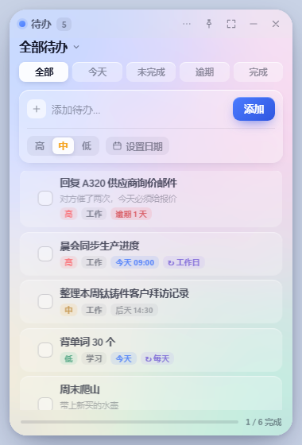
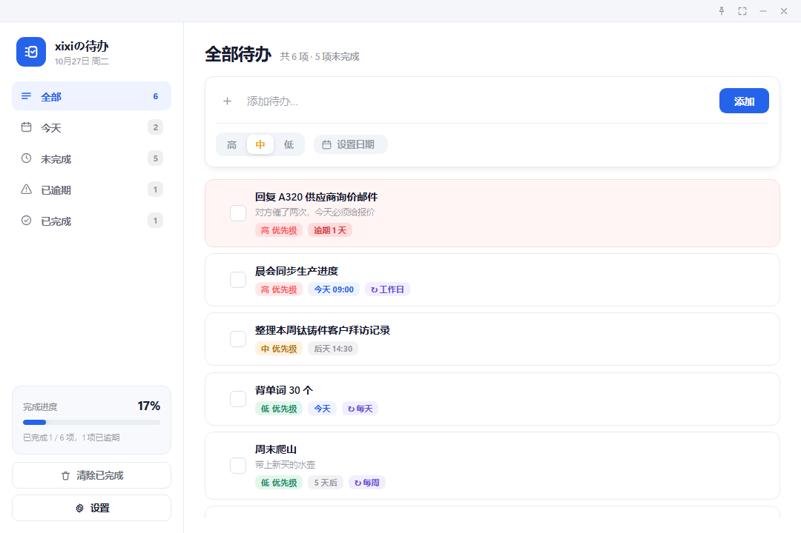
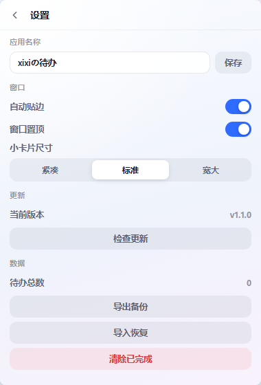

# xixiの待办清单·扁平桌面应用

Windows 桌面待办清单，扁平化视觉：纯色底、1px 分隔线、单一强调色，没有模糊与渐变光效。

**桌面小卡片**



**完整视图**



**设置页**（侧边栏底部或小卡片右下角进入，更新/备份/窗口配置都在这里）




---

## 更新日志

格式统一为「新增 / 修复 / 优化」，软件内更新弹窗用 `【新增】【修复】【优化】`，
这里和 GitHub Release 用 Markdown 形式。每个版本的完整说明见
[GitHub Releases](https://github.com/NiUKinGDoM/xixi-todo/releases)。

### v1.5.9
- **新增**：小卡片里加完待办后添加框自动收起，不用再点别处找地方关
- **修复**：保存失败不再被静默吞掉，会明确提示；关窗前先等数据写完；收进边缘时关掉半开的添加框
- **优化**：列表一次性挂载 DOM、位移动画分两阶段读布局；每条待办 9 个监听器改为整表 6 个；切筛选不做无意义位移；空闲计时节流

### v1.5.8
- **优化**：删除待办先淡出收高、后面的项滑上来；切筛选不再整列表重播进场；提示条淡出；
  弹窗与模式切换补齐退场/淡入；勾选完成的文字渐变；尊重系统「减少动画」

### v1.5.7
- **修复**：逾期任务每天都会再提醒；导入备份不再因编码或脏数据白屏；「下周一」不再算成两周后；
  副屏上贴边/切模式不跳回主屏；开关连点两下能生效；拖选文字松手到弹窗外不会误关
- **优化**：编辑框内容区加大两行；已下载的安装包不重复下载

### v1.5.6
- **移除**：没用的「卡片底色浓度」滑块
- **优化**：已完成划线加深加粗；进度条不再把置顶算进去；列表换位与弹窗/设置页动画重做；停掉小卡片常驻的模糊光斑

### v1.5.5
- **新增**：打开应用后自动检查更新（同一版本一天只提醒一次）
- **修复**：「检查更新」点下去立刻转圈，不再要点好几下

### v1.5.4
- **修复**：应用内更新弹「Windows 找不到 '\' 文件」；窗口状态偶发保存失败

### v1.5.3
- **新增**：设置页新增「卡片底色浓度」调节
- **修复**：改为单进程启动，任务管理器不再出现两个同名进程
- **优化**：置顶/编辑/删除改为悬停浮现；设置页保留顶栏

### v1.5.2
- **新增**：应用内直接更新（带进度、就地安装）；小卡片透明度可调；编辑框改三行；闲置 10 秒自动缩成三个点
- **修复**：日期/时间空值不再显示 `yyyy/mm/dd`、`--:--`

### v1.5.1
- **修复**：自动收起真的收成小条；两种收边方式改为二选一；设置页与编辑弹窗不再露出标题栏；编辑选项不再超出边界

### v1.5.0
- **新增**：小卡片改用「+」唤起添加抽屉；添加待办时可直接选重复周期
- **修复**：置顶卡死、按钮点空、拖动排序带着窗口跑、托盘菜单失灵
- **优化**：设置页开关整行可点

### v1.4.0
- **新增**：改为安装型应用；开机自启动；设置页集中管理；最小化收进边缘

---

## 安装

从 **[Releases](https://github.com/NiUKinGDoM/xixi-todo/releases/latest)** 下载
`xixi-todo-setup.exe`，双击安装：

- 装到 `%LOCALAPPDATA%\Programs\XiXiTodo`，**不需要管理员权限**，不弹 UAC
- 自动创建开始菜单与桌面快捷方式，安装时可勾选 **开机自启动**
- 控制面板「应用和功能」里能正常卸载
- 卸载**不删数据**，待办仍留在 `%APPDATA%\xixi-todo`，重装后接着用
- **升级**：下载新安装包直接运行即可覆盖安装，待办与窗口位置都不动
- 应用内「检查更新」会直接给你 Release 里的安装包地址

装完之后从桌面/开始菜单打开即可，和普通软件一样。应用内「检查更新」
也会直接给你新安装包的下载地址。

**两种形态，一键切换：**

- **桌面小卡片**（默认，380×560）—— 无边框圆角玻璃，浮在桌面上，默认置顶。适合挂在屏幕角落随手记事。
- **完整视图**（1080×720）—— 带侧边栏、进度统计、分类导航。

点标题栏的 ⛶ 按钮在两者间切换，数据完全共用。窗口位置、尺寸、置顶状态都会记住，下次打开回到原处。

**窗口操作用的是自绘标题栏**（因为无边框窗口没有系统标题栏）：

| 操作 | 位置 |
|---|---|
| 拖动窗口 | 按住标题栏左侧空白处拖动 |
| 自动贴边 | 拖到屏幕边缘松手即吸附（开关在设置里） |
| 自由缩放 | 拖右下角的小手柄，任意尺寸；设置里也有三档预设 |
| 应用改名 | 设置 → 名称，小卡片与完整视图同时生效 |
| 收进边缘 | 点最小化就缩成贴边小条（不管窗口在哪），点小条还原；可在设置里关掉 |
| 置顶开关 | 标题栏图钉按钮（高亮＝已置顶） |
| 小卡片 ⇄ 完整 | 标题栏 ⛶ 按钮 |
| 最小化 / 关闭 | 标题栏右端两个按钮 |
| 设置 | 完整视图：左侧栏底部「设置」；小卡片：右下角小齿轮 |

- 数据保存在 `%APPDATA%\xixi-todo\todos.json`
- 窗口状态保存在 `%APPDATA%\xixi-todo\window.json`
- 运行日志在 `%APPDATA%\xixi-todo\app.log`
- 安装包约 12 MB，安装不依赖管理员权限。免安装运行请复制 `build/payload/xixi-todo` **整个目录**，只拷 exe 会缺运行时文件

---

## 功能

| 功能 | 说明 |
|---|---|
| 添加待办 | 输入后按 `Enter` 或点「添加」 |
| 快速语法 | 一句话自动识别，见下表 |
| 优先级 | 高 / 中 / 低，列表按优先级排序 |
| 截止日期 | 点「设置日期」选择，自动换算「今天 / 明天 / N 天后」 |
| 提醒时间 | 精确到分钟，到点弹 Windows 系统通知 |
| 重复任务 | 每天 / 每个工作日 / 每周 / 每月 / 每年，完成后自动滚到下一次 |
| 备注 | 每个任务可加补充说明，列表里折叠显示 |
| 拖拽排序 | 按住任务左侧把手上下拖，手动调整顺序 |
| 逾期高亮 | 过期未完成整行标红，标签显示「逾期 N 天」 |
| 勾选完成 | 点左侧方框切换；重复任务则滚到下一次并记录完成次数 |
| 编辑 / 删除 | 悬停任务点铅笔 / 垃圾桶图标 |
| 分类筛选 | 全部 / 今天 / 未完成 / 已逾期 / 已完成 |
| 进度统计 | 完成百分比与逾期数量 |
| 备份恢复 | 设置 → 导出备份 / 导入恢复（JSON） |
| 开机自启动 | 设置 → 启动 → 开机自启动（安装包安装时也能勾） |

### 快速添加语法

在输入框里直接写自然语言，回车即可：

| 写法 | 效果 |
|---|---|
| `明天 交报告` | 截止日期设为明天 |
| `9点开会` / `9:30 开会` | 提醒时间 09:00 / 09:30 |
| `明天9点开会` | 日期 + 时间一起识别（不用加空格） |
| `写方案 !高` | 优先级高（`!中` `!低` 同理） |
| `周会 每周` | 每周重复（`每天` `工作日` `每月` `每年` 同理） |
| `下周三 汇报` | 解析成下周三的日期 |
| `10月30日 面试` / `10-30 面试` | 指定月日，已过则顺延到明年 |
| `明天9点 客户拜访 !高 每天` | 全部组合，一次设置完 |

输入框下方会实时显示解析结果（蓝色小标签），所见即所得。

### 重复任务怎么算

点勾选框时不会把任务标成已完成，而是把截止日期推到下一个周期、继续留在列表里，同时 `doneCount` 加一。

- 从**原截止日期**往后推，一路推到「今天或之后」，不会积压一串过期实例
- 每月 31 号遇到小月会压到月末（1/31 → 2/28）
- 「每个工作日」自动跳过周六日

### 快捷键

- `Enter` — 在输入框内快速添加
- `Ctrl + Enter` — 任意位置快速添加
- `Esc` — 关闭编辑弹窗 / 菜单

---

## 检查更新

软件打开约 1 秒后自动检查一次新版本。有新版本会直接弹出更新说明（同一版本一天只弹一次），
错过的话设置按钮上会留一个小红点。点 **设置 → 检查更新** 可随时手动检查。

### 更新源

版本信息放在仓库根目录的 `version.json`。四个清单源**并行请求，取版本号最高的那份**，
不按固定顺序 —— 镜像缓存新旧不一，串行「第一个成功就用」会一直读到旧版本：

| 源 | 说明 |
|---|---|
| `ghfast.top/...raw...` | 缓存最松，发版后基本立刻生效 |
| `gh-proxy.com/...raw...` | 备用反代，偶尔缓存旧清单 |
| `cdn.jsdelivr.net/gh/...` | 国内快，但对 `@main` 最长缓存 12 小时 |
| `raw.githubusercontent.com` | 官方源，国内常被拦，兜底 |
| GitHub Releases API | 不走缓存，只有版本号，用来兜住所有反代都过期的情况 |

**下载链接**（`version.json` 里的 `downloads`）用的是另一套顺序，因为实测发现：

- jsDelivr 出于安全策略**不代理 exe**（返回 403）
- GitHub raw 对大文件在国内常返回 502

所以下载走 `version.json` 里的 `downloads.mirrors`：ghfast / gh-proxy / ghproxy.net /
github.moeyy.xyz / gh.llkk.cc / GitHub 官方，六路并行探速后挑最快的那个下。

全部源都失败只会提示「检查失败，请检查网络」，不影响正常使用。

### 发新版本的步骤（每次改完必须走完）

**版本号不升 = 老用户永远收不到更新**，这一步最容易漏。

1. 改 `app.py` 的 `VERSION` 和 `version.json` 的 `version` / `date` / `notes`。
   **`notes` 必须按「【新增】/【修复】/【优化】」分类写**，每条以 `- ` 开头。
   GitHub Release 正文用 Markdown 标题 `## 新增` / `## 修复` / `## 优化`，
   本文件的更新日志用 `### 版本` + `- **新增**：`，三处分类保持一致
2. 打包两步：`venv\Scripts\python build.py` → `build_installer.py`
3. 跑全部测试：`run_tests.bat`（前端 + 窗口 + 后端 + 集成）
4. `git add -A` → commit → push
5. 创建 Release（tag = `v版本号`），上传安装包为**固定资产名** `xixi-todo-setup.exe`
6. 清 jsDelivr 缓存：
   `curl "https://purge.jsdelivr.net/gh/NiUKinGDoM/xixi-todo@main/version.json"`
7. 复核远程 `version.json` 和 `releases/latest` 都已是新版本

资产名保持固定，配合 `releases/latest/download/xixi-todo-setup.exe`，
以后发版不用改下载地址。安装包只在 Release 发布，不进仓库。

推上去后，已经装了旧版的用户在下次打开时就会收到更新提示。

> 注意：`version.json` 的 `downloads` 指向 **Release 资产**
> （`releases/latest/download/xixi-todo-setup.exe`），带 gh-proxy / ghfast 加速前缀。
> 仓库里**不再存二进制**，克隆体积不会随版本膨胀。
>
> `dist` 只是本地构建产物，已加入 `.gitignore`。便携版已经取消 ——
> 两个入口容易误点，而且便携版和安装版共用同一个数据目录，双开容易互相覆盖。

---

## 视觉：扁平布局 + 玻璃材质

**布局是扁平的**：侧边栏与主区之间只有一条分隔线，不做浮起来的卡片式面板。
层次靠三样东西：浅色底（`#eef1f8`）、白色表面、1px 发丝线（`#e6eaf2`）。
强调色 `#2f6bff` 只用在主按钮、选中态、开关打开态。

**材质是玻璃感的**：

- 背景层有四团缓慢漂移的极光色斑（`.bg-orb`），给折射提供内容
- 主区顶部的 `.hero` 用 SVG 滤镜 `lgRefract` 做位移 + 三通道色散，模拟真折射
- 卡片与面板用 `backdrop-filter` 磨砂，配内描边高光
- 窗口圆角交给 Windows 11 的 DWM 绘制（抗锯齿、带系统投影），老系统才退回 GDI 区域

小卡片里会停掉极光动画 —— 常驻的高斯模糊重绘是掉帧主要来源。
系统开了「减少动画」时，所有过渡会自动压到 1ms。

---

## 从源码重新构建

```bash
# 1. 准备环境（只需一次）
python -m venv venv
venv\Scripts\pip install pywebview pyinstaller pillow

# 2. 生成图标（改了配色才需要）
venv\Scripts\python make_icon.py

# 3. 打包应用本体（中间产物，不直接发布）
venv\Scripts\python build.py
# 产物：build\payload\xixi-todo.exe

# 4. 打包安装包（需要 Inno Setup 6）
winget install JRSoftware.InnoSetup
venv\Scripts\python build_installer.py
# 产物：dist\xixiの待办清单-安装包.exe
```

安装包脚本由 `build_installer.py` 现场生成（版本号从 `version.json` 读），
中文界面靠 `installer/ChineseSimplified.isl`，不依赖系统语言。

### 开发时快速预览

```bash
# 直接开界面（数据走 localStorage，不落盘）
start ui\index.html

# 跑完整桌面壳（真实 WebView2 + 真实数据）
venv\Scripts\python app.py
```

---

## 测试

```bash
run_tests.bat
```

两套测试：

| 测试 | 覆盖 | 数量 |
|---|---|---|
| `tests/smoke.js`（Chrome headless 注入） | 增删改查、快速语法、筛选排序、统计、重复周期、设置页、拖拽排序（真实事件）、动画与脏数据容错 | 148 项 |
| `test_window.py`（无需 GUI） | 模式切换、位置快照、置顶、状态落盘、屏幕边界、收起/展开、自启动注册表守卫 | 66 项 |
| `test_features.py`（无需 GUI） | 文件存储、备份导出/导入、提醒判定与宽限期、更新日期键 | 43 项 |
| `test_integration.py`（真实 WebView2） | Store 读写、损坏数据容错、JS↔Python 桥接、启动加载、交互后落盘 | 16 项 |

合计 **273 项**。另有 `tests/gui_*.py` 一组真实窗口探针：交互巡检、按钮命中、
文件对话框、动效量化、性能基线、开关状态同步、含 GUI 的更新/安装流程等。

界面截图与真实窗口抓图：

```bash
venv\Scripts\python tests\grab_window.py out.png   # 抓运行中的窗口
```

---

## 项目结构

```
todo-glass/
├── app.py                 桌面壳：窗口形态、数据持久化、单实例锁、到期提醒
├── build.py               PyInstaller 打包脚本
├── build_installer.py     生成 Inno Setup 脚本并编译安装包
├── installer/             安装包模板（setup.iss 自动生成）与中文语言包
├── make_icon.py           图标生成（多尺寸 ICO，4x 超采样）
├── test_integration.py    真实 WebView2 数据集成测试
├── test_window.py         窗口形态逻辑测试（无需 GUI）
├── test_features.py       备份/提醒等后端逻辑测试（无需 GUI）
├── run_tests.bat          一键回归测试
├── ui/
│   ├── index.html         界面结构 + SVG 折射滤镜定义
│   ├── styles.css         材质体系、迷你/完整两套布局
│   ├── app.js             业务逻辑、快速语法解析、渲染、桥接、窗口控制
│   ├── app.ico            应用图标
│   ├── preview-mini.png   小卡片预览
│   ├── preview.png        完整视图预览
│   └── preview-settings.png 设置页预览
├── tests/
│   ├── smoke.js           前端冒烟测试用例（148 项）
│   ├── make-test.js       生成注入测试副本
│   ├── gui_audit.py       真实窗口交互一条龙巡检
│   ├── gui_perf.py        列表渲染性能基线
│   ├── gui_motion.py      动效量化（进场/退场/滚动复位）
│   ├── gui_hit.py         按钮真实命中检查
│   ├── gui_dialog.py      文件对话框可用性
│   ├── gui_statesync.py   开关连点与更新包复用
│   └── gui_shot2.py       视觉验收截图
└── dist/
    └── xixiの待办清单-安装包.exe  ← 本地构建产物（不进仓库，上传到 Release）
```

---

## 技术要点与坑位记录

1. **必须传普通文件路径，不能传 `file://`**
   pywebview 的 `is_local_url()` 对 `file://` 返回 False，本地静态服务器不会启动，而 JS API 桥接走的是该服务器的 `/js_api/{uid}` POST 路由。用 `file://` 会导致**数据完全无法保存**。

2. **启动时序**
   `app.js` 作为页面普通脚本执行时，pywebview 尚未注入 `window.pywebview`。若只在桥接存在时才监听 `pywebviewready`，会永久错过事件、只读到空的 localStorage。正确做法：先启动一次，桥接就绪后再启动一次，并用序列号防止旧结果覆盖新结果。

3. **`hidden` 属性会被组件 `display` 覆盖**
   `.modal-mask { display: grid }` 的类选择器优先级高于浏览器默认的 `[hidden] { display: none }`，导致弹窗永远显示。需要显式写 `[hidden] { display: none !important }`。

4. **CSS 同特异性规则按顺序覆盖**
   `.tag-overdue` 与 `.tag-date` 特异性相同，后者在后声明会覆盖前者，导致逾期红色不生效。把逾期规则移到后面。

5. **嵌套 `backdrop-filter` 失效**
   祖先元素有 `backdrop-filter` 时，子元素的滤镜只能采样父层内部内容，折射会消失。所以折射只挂最外层面板。

6. **Windows 通知**
   通过 PowerShell 调 `Windows.UI.Notifications`，无需安装 win10toast 等第三方库。
   要检查子进程返回码：以前无条件当成功，通知没弹出来也毫无日志。

7. **无边框窗口的尺寸会少一圈边框**
   pywebview 在 Windows 上先按「带边框」的 Size 设置窗口，之后才切成无边框，导致客户区少掉边框厚度（380×560 实际变成 364×521）。必须在 `shown` 事件里再 `resize` 一次拉回设计尺寸。

8. **展开大窗口会跑出屏幕**
   小卡片贴在右下角时，按原位置展开 1080×720 会有一半在屏幕外。切换模式后必须按新尺寸重新钳制坐标（`clamp_to_screen`），并把钳制后的位置写回状态。

9. **无边框窗口没有系统标题栏**
   拖动、最小化、关闭全部要自己做：拖拽区用 `.pywebview-drag-region`（`DRAG_REGION_DIRECT_TARGET_ONLY = False` 时区内子元素也会触发拖动，所以窗口按钮必须放在拖拽区**外面**）；最小化/关闭通过 js_api 调 `window.minimize()` / `window.destroy()`。

10. **单实例锁不要写在模块顶层**
    否则任何 `import app` 的测试都会被锁挡住直接退出。收进函数、只在 `main()` 里调用。

11. **圆角不要用 SetWindowRgn**
    窗口区域是**二值遮罩**，没有抗锯齿。22px 圆角裁出来能清楚看到一格格的阶梯。正确做法是 Windows 11 的 `DwmSetWindowAttribute(hwnd, DWMWA_WINDOW_CORNER_PREFERENCE, DWMWCP_ROUND)`：由系统合成器绘制，边缘抗锯齿、还自带投影，代价是半径由系统决定，不能自定义。同时要 `SetWindowRgn(hwnd, None, True)` 清掉历史区域，否则两套裁切会叠加。
    另外 `transparent=True` 在 WebView2 上并不真的生效（窗口底色仍是不透明浅灰，只在页面留白的地方露出一圈白边），所以别指望它做圆角——但 `shadow=True` 必须开，它决定 pywebview 是否走 DWM 渲染策略，而这是原生圆角生效的前提。真透明的三种方案都试过了，结论见文末第 24 条。

12. **窗口区域与页面圆角不能同时画**
    窗口本身不透明，若页面再画一次 `border-radius`，圆角与窗口边界之间的那块就会露出页面底色，形成缺口。要么全交给系统，要么全交给页面。

13. **中文输入不带空格**
    快速语法的正则一开始用 `(?=\s|$)` 作边界，结果「明天9点开会」完全解析不出来。中文用户不会在词之间敲空格，所以边界必须放宽到「空格 / 数字 / 行尾 / 非 ASCII 字符」。

14. **解析顺序会互相破坏**
    必须先解析日期再解析时间：日期被替换成空格后，时间正则才有分隔符可用；反过来「明天9点」里的时间会先被漏掉。

15. **js_api 的多参数调用**
    `callApi(name, arg)` 只透传一个参数，像 `resize_window(w, h)` 这种两参接口会被截断成单参，静默失败、什么都不发生。改成传数组并用 `apply` 展开。

16. **WebView2 没有 window.prompt**
    重命名这类需要输入的地方不能用 `prompt()`；`confirm()` 各版本行为也不一致。统一换成自绘弹窗（Promise 化），顺带还能统一视觉。

17. **别在 js_api 回调里改 WinForms 属性**
    收起成 20px 小条要先解除窗口最小尺寸限制。直接写 `form.MinimumSize` 时：
    调**小**没事（不触发尺寸变化），调**大**会让 WinForms 走 `Invoke` 回 UI 线程，
    而 js_api 回调本来就在非 UI 线程 —— 直接死锁，没有异常、没有日志，页面永远等不到返回。
    最终方案是创建窗口时就把 `min_size` 设成 `(1,1)`，最小尺寸由业务代码自己钳制。

18. **拖动结束的事件要自己造**
    pywebview 的 `moved` 在拖动过程中持续触发，没有「松手」事件，而且原生拖拽会把鼠标捕获交给系统，页面收不到 `mouseup`。用防抖解决：每次移动重置一个 0.45s 定时器，到期才算拖完，此时再做边缘吸附。

19. **提醒要设宽限期**
    到点提醒如果无条件补发，晚上 11 点打开应用会被早上 9 点的提醒轰炸。现在超过 6 小时只把去重键记录进 `notified.json`、不弹窗，避免陈旧打扰。

20. **提醒去重键必须带日期**
    键只用 `任务id|截止日期` 的话，逾期任务提醒过一次就永远不响了。
    现在逾期键带当天日期（`id|due|overdue|今天`），每期/每天都能正常触发。

21. **headless 里点下载链接会挂死**
    测试备份导出时 `a.click()` 触发真实下载，Chrome 卡住不返回。测试里把 `URL.createObjectURL` 和 `HTMLAnchorElement.prototype.click` 打桩掉即可。

22. **程序化改窗口会触发 moved，刚展开就被吸回边上**
    展开贴边小条、切尺寸、切模式都会 `resize` / `move`，pywebview 照样抛 `moved` 事件，
    防抖 0.45 秒后自动贴边就把窗口拽回屏幕边 —— 用户看到的是「点展开之后窗口自己跑了」。
    解法：这类程序化操作调用 `_mute_snap()`，在 1 秒内跳过自动贴边；拖动结束的吸附照常。

23. **冷启动不能沿用「收起」状态**
    收起态（20×104 的贴边小条）只适合当前会话。上次如果是收起状态退出、甚至被强杀，
    再启动就会变成屏幕边一条 20px 的缝。`load_state()` 里直接把它重置为 False。

24. **真透明在 WebView2 上走不通**
    色键打洞（`WS_EX_LAYERED` + `LWA_COLORKEY`）能让桌面真透出来、字也清楚，
    但分层窗口的命中测试不再包含 WebView2 内容 —— 整个窗口点不动。
    DWM 亚克力在 WebView2 上不渲染，`transparent=True` 只露出一圈浅灰白边。
    代码里留了函数和结论注释，别再接回去。

25. **别在 js_api 回调里等文件对话框以外的同步 UI 操作**
    导出/导入的文件对话框实测不会死锁（UI 线程仍在跑消息循环），
    但置顶/改名/最小化这类直接改 WinForms 属性的会 —— 一律走 `user32`。

26. **保存失败不能只看 `.catch()`**
    pywebview 把 Python 返回值原样传回来，写盘失败时是 `False` 而不是 rejection。
    只挂在 `.catch()` 上会静默吞掉，用户以为存上了其实没存。关窗也要先等保存完成再退出。

---

## 系统要求

- Windows 10 1809 及以上 / Windows 11
- 需要 Microsoft Edge WebView2 运行时（Windows 11 自带；Windows 10 通常随 Edge 安装）
- 若提示缺少 WebView2，可从微软官网下载「WebView2 Runtime」安装包
