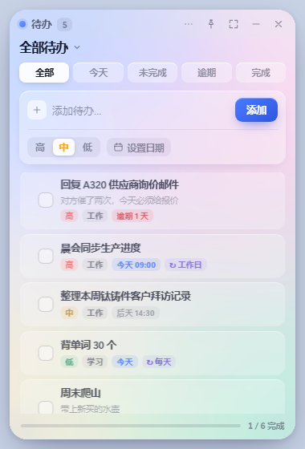
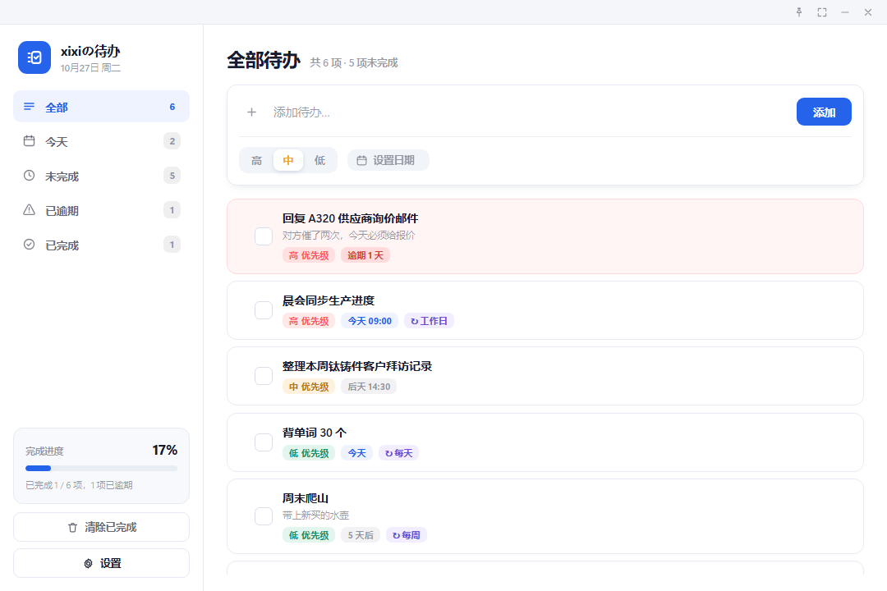

# xixiの待办清单 · Liquid Glass 桌面应用

Windows 桌面待办清单，采用 Apple Liquid Glass（液态玻璃）视觉语言。

**桌面小卡片**



**完整视图**




---

## 直接使用

双击 **`dist\xixiの待办清单.exe`** 即可运行，无需安装 Python 或任何运行时。

**两种形态，一键切换：**

- **桌面小卡片**（默认，380×560）—— 无边框圆角玻璃，浮在桌面上，默认置顶。适合挂在屏幕角落随手记事。
- **完整视图**（1080×720）—— 带侧边栏、进度统计、分类导航。

点标题栏的 ⛶ 按钮在两者间切换，数据完全共用。窗口位置、尺寸、置顶状态都会记住，下次打开回到原处。

**窗口操作用的是自绘标题栏**（因为无边框窗口没有系统标题栏）：

| 操作 | 位置 |
|---|---|
| 拖动窗口 | 按住标题栏左侧空白处拖动 |
| 置顶开关 | 标题栏图钉按钮（高亮＝已置顶） |
| 小卡片 ⇄ 完整 | 标题栏 ⛶ 按钮 |
| 最小化 / 关闭 | 标题栏右端两个按钮 |

- 数据保存在 `%APPDATA%\TodoGlass\todos.json`
- 窗口状态保存在 `%APPDATA%\TodoGlass\window.json`
- 运行日志在 `%APPDATA%\TodoGlass\app.log`
- 单文件绿色版，约 12 MB，可直接复制到其他 Windows 电脑使用

---

## 功能

| 功能 | 说明 |
|---|---|
| 添加待办 | 输入后按 `Enter` 或点「添加」 |
| 快速语法 | 一句话自动识别，见下表 |
| 优先级 | 高 / 中 / 低，列表按优先级排序 |
| 截止日期 | 点「设置日期」选择，自动换算「今天 / 明天 / N 天后」 |
| 提醒时间 | 精确到分钟，到点弹 Windows 系统通知 |
| 重复任务 | 每天 / 每个工作日 / 每周 / 每月 / 每年，完成后自动滚到下一次 |
| 分组 | 工作 / 生活 / 学习 等，可新建；点标题或侧边栏按分组筛选 |
| 备注 | 每个任务可加补充说明，列表里折叠显示 |
| 拖拽排序 | 按住任务左侧把手上下拖，手动调整顺序 |
| 逾期高亮 | 过期未完成整行标红，标签显示「逾期 N 天」 |
| 勾选完成 | 点左侧方框切换；重复任务则滚到下一次并记录完成次数 |
| 编辑 / 删除 | 悬停任务点铅笔 / 垃圾桶图标 |
| 分类筛选 | 全部 / 今天 / 未完成 / 已逾期 / 已完成 |
| 进度统计 | 完成百分比与逾期数量 |
| 备份恢复 | 标题栏 ⋯ 菜单 → 备份导出 / 导入恢复（JSON） |

### 快速添加语法

在输入框里直接写自然语言，回车即可：

| 写法 | 效果 |
|---|---|
| `明天 交报告` | 截止日期设为明天 |
| `9点开会` / `9:30 开会` | 提醒时间 09:00 / 09:30 |
| `明天9点开会` | 日期 + 时间一起识别（不用加空格） |
| `写方案 !高` | 优先级高（`!中` `!低` 同理） |
| `整理资料 #工作` | 归入「工作」分组，分组不存在会自动创建 |
| `周会 每周` | 每周重复（`每天` `工作日` `每月` `每年` 同理） |
| `下周三 汇报` | 解析成下周三的日期 |
| `10月30日 面试` / `10-30 面试` | 指定月日，已过则顺延到明年 |
| `明天9点 客户拜访 !高 #工作 每天` | 全部组合，一次设置完 |

输入框下方会实时显示解析结果（蓝色小标签），所见即所得。

### 重复任务怎么算

点勾选框时不会把任务标成已完成，而是把截止日期推到下一个周期、继续留在列表里，同时 `doneCount` 加一。

- 从**原截止日期**往后推，一路推到「今天或之后」，不会积压一串过期实例
- 每月 31 号遇到小月会压到月末（1/31 → 2/28）
- 「每个工作日」自动跳过周六日

### 快捷键

- `Enter` — 在输入框内快速添加
- `Ctrl + Enter` — 任意位置快速添加
- `Esc` — 关闭编辑弹窗 / 菜单

---

## 检查更新

软件打开约 4 秒后会自动静默检查一次新版本（不打扰，只在标题栏 ⋯ 按钮上点一个小红点）。
点 ⋯ → **检查更新** 可以手动检查，有新版本会弹出更新说明并给出下载入口。

### 更新源

版本信息放在仓库根目录的 `version.json`，按以下顺序依次尝试，任意一个成功即用：

| 顺序 | 源 | 说明 |
|---|---|---|
| 1 | `raw.githubusercontent.com` | 永远是最新的，保证发版后立刻生效 |
| 2 | `cdn.jsdelivr.net/gh/...` | 国内快，但对 `@main` 有最长 12 小时缓存 |
| 3 | `gh-proxy.com` | GitHub 加速镜像 |
| 4 | `ghfast.top` | 备用镜像 |

**下载链接**（`version.json` 里的 `downloads`）用的是另一套顺序，因为实测发现：

- jsDelivr 出于安全策略**不代理 exe**（返回 403）
- GitHub raw 对大文件在国内常返回 502

所以下载走 `gh-proxy` → `ghfast` → GitHub 页面，这三个都实测可用。

全部源都失败只会提示「检查失败，请检查网络」，不影响正常使用。

### 发新版本的步骤

1. 改 `app.py` 里的 `VERSION`
2. 改 `version.json` 的 `version`、`date`、`notes`
3. `python build.py` 重新打包
4. 提交并推送：

```bash
git add -A
git commit -m "release: v1.1.1"
git push
```

推上去后，已经装了旧版的用户在下次打开时就会收到更新提示。

> 注意：`version.json` 里的下载链接指向 `dist/xixi-todo.exe`（英文别名）。
> 用英文名而不是中文名，是为了让镜像服务对 URL 的转义不会出问题。

> 如果改完 12 小时内发现用户没收到更新，可以手动清一下 jsDelivr 缓存：
> `curl "https://purge.jsdelivr.net/gh/NiUKinGDoM/xixi-todo@main/version.json"`

---

## 视觉实现：真 Liquid Glass

不只是普通磨砂玻璃，而是用 SVG 滤镜做了**真实的光学折射**：

```
背景动态极光层
    ↓
feGaussianBlur(26)      ← 先散射（磨砂）
    ↓
feDisplacementMap(44)   ← 用 feTurbulence 噪声做透镜位移
    ↓
三通道分离 + 偏移        ← 制造边缘色散彩边
    ↓
feBlend(screen) 合回
    ↓
backdrop-filter: url(#lgRefract)
```

三条材质层级：

- `.glass-refract` — 主面板，挂 SVG 折射滤镜（WebView2 / Chromium 专属特性）
- `.glass-panel` — 侧边栏、弹窗，`backdrop-filter: blur(32px) saturate(115%)`
- 卡片与控件 — 半透明白层，不再叠加滤镜（祖先 `backdrop-filter` 会创建 backdrop root，子元素再叠会失效）

---

## 从源码重新构建

```bash
# 1. 准备环境（只需一次）
python -m venv venv
venv\Scripts\pip install pywebview pyinstaller pillow

# 2. 生成图标（改了配色才需要）
venv\Scripts\python make_icon.py

# 3. 打包
venv\Scripts\python build.py
# 产物：dist\xixiの待办清单.exe（另存一份 dist\xixi-todo.exe 供更新下载）
```

### 开发时快速预览

```bash
# 直接开界面（数据走 localStorage，不落盘）
start ui\index.html

# 跑完整桌面壳（真实 WebView2 + 真实数据）
venv\Scripts\python app.py
```

---

## 测试

```bash
run_tests.bat
```

两套测试：

| 测试 | 覆盖 | 数量 |
|---|---|---|
| `tests/smoke.js`（Chrome headless 注入） | 增删改查、优先级、逾期判定、筛选、排序、统计、持久化、元素遮挡、Liquid Glass 样式、迷你/完整模式、重复周期、分组、备注、快速语法、拖拽排序、菜单 | 98 项 |
| `test_window.py`（无需 GUI） | 模式切换的 resize/move、位置快照、置顶开关、状态落盘与容错、屏幕边界钳制、无窗口健壮性 | 33 项 |
| `test_features.py`（无需 GUI） | 分组存储与容错、备份导出/导入（含取消与文件缺失）、全字段往返、提醒判定与宽限期 | 35 项 |
| `test_integration.py`（真实 WebView2） | Store 读写、损坏数据容错、JS↔Python 桥接、启动自动加载、交互后落盘、重载读最新 | 16 项 |

合计 **182 项**。

界面截图与真实窗口抓图：

```bash
venv\Scripts\python tests\grab_window.py out.png   # 抓运行中的窗口
```

---

## 项目结构

```
todo-glass/
├── app.py                 桌面壳：窗口形态、数据持久化、单实例锁、到期提醒
├── build.py               PyInstaller 打包脚本
├── make_icon.py           图标生成（多尺寸 ICO，4x 超采样）
├── test_integration.py    真实 WebView2 数据集成测试
├── test_window.py         窗口形态逻辑测试（无需 GUI）
├── test_features.py       分组/备份/提醒逻辑测试（无需 GUI）
├── run_tests.bat          一键回归测试
├── ui/
│   ├── index.html         界面结构 + SVG 折射滤镜定义
│   ├── styles.css         材质体系、迷你/完整两套布局
│   ├── app.js             业务逻辑、快速语法解析、渲染、桥接、窗口控制
│   ├── app.ico            应用图标
│   ├── preview-mini.png   小卡片预览
│   └── preview.png        完整视图预览
├── tests/
│   ├── smoke.js           前端冒烟测试用例
│   ├── make-test.js       生成注入测试副本
│   ├── seed.js            截图用示例数据
│   ├── grab_window.py     抓取运行窗口截图
│   └── click_mode.py      真实鼠标点击验证形态切换
└── dist/
    ├── xixiの待办清单.exe   ← 交付物
    └── xixi-todo.exe         ← 同内容英文别名（更新检查用）
```

---

## 技术要点与坑位记录

1. **必须传普通文件路径，不能传 `file://`**
   pywebview 的 `is_local_url()` 对 `file://` 返回 False，本地静态服务器不会启动，而 JS API 桥接走的是该服务器的 `/js_api/{uid}` POST 路由。用 `file://` 会导致**数据完全无法保存**。

2. **启动时序**
   `app.js` 作为页面普通脚本执行时，pywebview 尚未注入 `window.pywebview`。若只在桥接存在时才监听 `pywebviewready`，会永久错过事件、只读到空的 localStorage。正确做法：先启动一次，桥接就绪后再启动一次，并用序列号防止旧结果覆盖新结果。

3. **`hidden` 属性会被组件 `display` 覆盖**
   `.modal-mask { display: grid }` 的类选择器优先级高于浏览器默认的 `[hidden] { display: none }`，导致弹窗永远显示。需要显式写 `[hidden] { display: none !important }`。

4. **CSS 同特异性规则按顺序覆盖**
   `.tag-overdue` 与 `.tag-date` 特异性相同，后者在后声明会覆盖前者，导致逾期红色不生效。把逾期规则移到后面。

5. **嵌套 `backdrop-filter` 失效**
   祖先元素有 `backdrop-filter` 时，子元素的滤镜只能采样父层内部内容，折射会消失。所以折射只挂最外层面板。

6. **Windows 通知**
   通过 PowerShell 调 `Windows.UI.Notifications`，无需安装 win10toast 等第三方库。

7. **无边框窗口的尺寸会少一圈边框**
   pywebview 在 Windows 上先按「带边框」的 Size 设置窗口，之后才切成无边框，导致客户区少掉边框厚度（380×560 实际变成 364×521）。必须在 `shown` 事件里再 `resize` 一次拉回设计尺寸。

8. **展开大窗口会跑出屏幕**
   小卡片贴在右下角时，按原位置展开 1080×720 会有一半在屏幕外。切换模式后必须按新尺寸重新钳制坐标（`clamp_to_screen`），并把钳制后的位置写回状态。

9. **无边框窗口没有系统标题栏**
   拖动、最小化、关闭全部要自己做：拖拽区用 `.pywebview-drag-region`（`DRAG_REGION_DIRECT_TARGET_ONLY = False` 时区内子元素也会触发拖动，所以窗口按钮必须放在拖拽区**外面**）；最小化/关闭通过 js_api 调 `window.minimize()` / `window.destroy()`。

10. **单实例锁不要写在模块顶层**
    否则任何 `import app` 的测试都会被锁挡住直接退出。收进函数、只在 `main()` 里调用。

11. **透明窗口的圆角自己画**
    `transparent=True` 后 DWM 不再给窗口加圆角/阴影，圆角、投影全部由页面 CSS 完成；背景层要从 `fixed` 改成受卡片裁剪，否则光斑会溢出圆角。

12. **中文输入不带空格**
    快速语法的正则一开始用 `(?=\s|$)` 作边界，结果「明天9点开会」完全解析不出来。中文用户不会在词之间敲空格，所以边界必须放宽到「空格 / 数字 / 行尾 / 非 ASCII 字符」。

13. **解析顺序会互相破坏**
    必须先解析日期再解析时间：日期被替换成空格后，时间正则才有分隔符可用；反过来「明天9点」里的时间会先被漏掉。

14. **提醒要设宽限期**
    到点提醒如果无条件补发，晚上 11 点打开应用会被早上 9 点的提醒轰炸。现在超过 6 小时只把去重键记录进 `notified.json`、不弹窗，避免陈旧打扰。

15. **提醒去重键必须带日期**
    键只用任务 id 的话，重复任务滚到下一次就不会再提醒了。改用 `id|due|time` 后每期都能正常触发。

16. **headless 里点下载链接会挂死**
    测试备份导出时 `a.click()` 触发真实下载，Chrome 卡住不返回。测试里把 `URL.createObjectURL` 和 `HTMLAnchorElement.prototype.click` 打桩掉即可。

---

## 系统要求

- Windows 10 1809 及以上 / Windows 11
- 需要 Microsoft Edge WebView2 运行时（Windows 11 自带；Windows 10 通常随 Edge 安装）
- 若提示缺少 WebView2，可从微软官网下载「WebView2 Runtime」安装包
